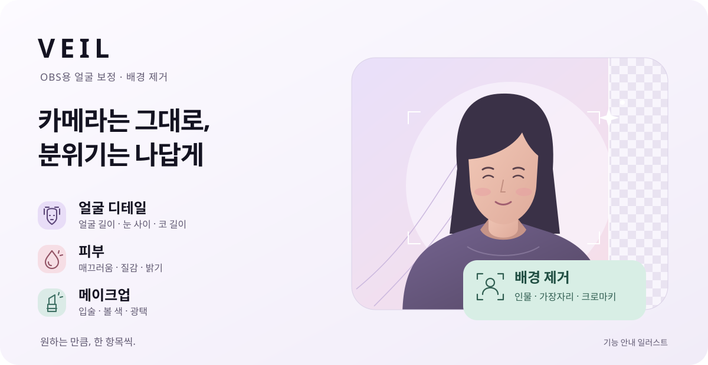

# VEIL 0.4.7

OBS 카메라에 얼굴·피부·메이크업 보정과 배경 제거를 더하세요.

**[Windows 설치 파일 받기](https://github.com/VEIL05/veil-obs-filter/releases/download/v0.4.7/VEIL-OBS-Filter-Setup.exe)**

## 시작하기

1. OBS를 완전히 종료하고 `VEIL-OBS-Filter-Setup.exe`를 실행하세요.
2. **VEIL 설치** 또는 **VEIL 업데이트**를 누르세요.
3. OBS를 다시 열고 **카메라 소스 → 필터 → ＋ → VEIL 필터 · 얼굴·피부·메이크업**을 추가하세요.

배경 제거는 **조절할 항목 → 배경 제거 → 배경 필터 추가**에서 시작합니다.
일반 배경에서는 **인물**, 초록 천 등 단색 배경에서는 **크로마키**를 선택하세요.
윤곽은 **가장자리**에서 따로 다듬을 수 있습니다.

## 제공하는 기능

- **얼굴 디테일** — 얼굴 길이, 눈 사이, 코 길이 등 세부 조절
- **피부·메이크업** — 매끄러움과 질감, 입술·볼 색, 광택
- **빛·색감** — 밝기, 색감, 전체 보정 강도, 좌우 반전
- **배경 제거** — 자동 인물 제거, 윤곽 떨림 줄이기, 가장자리 부드러움, 크로마키
- **설정 보관** — 프리셋 저장·불러오기, OBS 장면에 설정 유지

**Windows 64비트 · OBS Studio 33.0.1**을 기준으로 확인했습니다.
원본·좌우 비교·마스크 보기 화면은 방송과 녹화에도 표시되므로, 확인 후 **보정 영상**으로 돌려놓으세요.

## 파일 안내

| 파일 | 용도 |
| --- | --- |
| `VEIL-OBS-Filter-Setup.exe` | 설치·업데이트·설치 되돌리기 |
| `VEIL-0.4.7-Source.zip` | 이 버전의 소스, 빌드·설치 스크립트, 원본 소스 아카이브와 고지 |
| `SHA256SUMS.txt` | 다운로드 파일의 SHA-256 확인값 |

공개 설치 파일은 기본 보정값으로 시작합니다. 기존 OBS 장면에 저장된 필터 설정은 유지됩니다.
이미지는 기능 안내용 일러스트이며 실제 카메라 보정 전후 사진이 아닙니다.

[한국어 사용 안내](https://github.com/VEIL05/veil-obs-filter/blob/v0.4.7/README.md) · [문제 제보](https://github.com/VEIL05/veil-obs-filter/issues)

## 출처와 소스

[사용·참고 프로젝트](https://github.com/VEIL05/veil-obs-filter/blob/v0.4.7/CREDITS.md),
[구성요소별 라이선스](https://github.com/VEIL05/veil-obs-filter/blob/v0.4.7/docs/LICENSING.md),
[원본 소스·정확한 버전·추가 빌드 자료](https://github.com/VEIL05/veil-obs-filter/blob/v0.4.7/docs/DEPENDENCY-SOURCES.md)를 함께 제공합니다.
GPL·MIT·Apache 등 각 구성요소의 원래 조건을 유지합니다. Microsoft DirectML은 Microsoft의 별도 조건이 적용됩니다.
